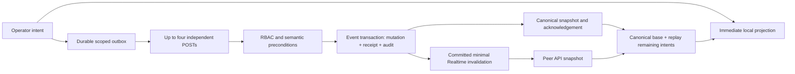

# Queue collaboration: local intentions and confirmed shared state

Date: 2026-10-17. Base: `703c145dc21a2b1eb58370a93058402ffbb4f48b`, branch `feat/kunestu-participant-model-fair-queue`. Foundation `721a1dd35caec0666d099024a344628c6e075c1c` is retained. This task makes no remote changes, commits, pushes or deployments.

## Diagnosis and architecture

See [ADR](../architecture/adr-queue-collaboration.md). The previous global Promise chain blocked all writes behind one HTTP request; placement busy state disabled the entire board; snapshots waited behind all outstanding mutations. Whole-queue revision comparisons rejected independent edits, and retries lacked transactional receipts. An old start request could finish a performance started by another operator.

The panel now renders a canonical base with a replayed intention log immediately. IndexedDB persists up to 64 small intentions before any POST. Up to four independent HTTP writes run concurrently. Same-song, neighbour-dependent and performance operations retain dependency order. Each write has an immutable UUID, actor/device correlation, source status and semantic version. Moves target surviving neighbour IDs, not stale integer positions. Explicit Fair Sort is a placement barrier. Invalid source, neighbour or performance preconditions produce a visible conflict; they never silently overwrite the other operator.

The authoritative database still serializes event transactions with existing lifecycle/session locks, preserves contiguous positions, and enforces RBAC, event scope, capacity 2/2 and the unchanged Fair Queue algorithm. Mutation, operation receipt and correlated audit commit atomically. Repeated UUIDs return the current canonical snapshot; the same UUID with different actor/device/payload is denied. A start compares the observed current performance before completing anything. Device IDs are correlation metadata, never credentials or permissions.

The client accepts newer API snapshots while writes are pending, removes verified receipt acknowledgements and replays remaining intentions. An older snapshot cannot replace newer rows. A changed drag context cancels the gesture visibly. Errors retain intentions; a terminal conflict shows canonical rows and requires an explicit decision. In-flight/ambiguous commits cannot be discarded. Account switching cannot replay another account's outbox. Responsive duplicate mounts share one writer and transport within the tab.

Realtime remains a minimal invalidation signal. One event revision/private broadcast is written per transaction; it becomes visible after commit. Clients deduplicate against trusted API revisions, detect gaps, and fetch coherent snapshots on subscription, reconnect and focus. A forged high broadcast revision never becomes a permanent trusted watermark. No polling or browser reads of business tables were introduced. Public/participant topic contracts are retained.

The badge distinguishes local, saving, synced, conflict and offline states. Rows whose status/order is not confirmed remain marked. No mutation success toast precedes a server acknowledgement. Rejection confirmation is retained. Fair Sort waits for local intentions to resolve because it is an explicit whole-queue operation; ordinary actions and DnD do not wait for unrelated requests.

## Migration and compatibility

Prepared migration `0032_queue_collaboration.sql` adds `song_requests.intent_version` with constant default zero, private RLS-protected `queue_streams` and `queue_operation_receipts`, and restricted trigger functions. It preserves existing positions and domain data. Semantic versions advance for primary explicit moves/status changes, not incidental renumbering. Stream metadata also versions no-op Fair Sort and lifecycle changes. Event deletion cannot recreate a stream for a deleted parent.

Only fresh owned PostgreSQL 17/Supabase test databases were migrated. No existing development, shared or production database was migrated. The generated Drizzle snapshot and journal are included; earlier migrations are unchanged.

Before a separately authorised release: verify history/hashes, create and restore-test a backup, apply 0032 before the new application, verify browser-role denial and queue health, then deploy to the existing environment. Old unconditioned action/move HTTP payloads deliberately return `409 QUEUE_SYNC_REQUIRED`: old tabs must refresh, rather than bypass conflict protection. Their route addresses stay unchanged; versioned envelopes are accepted. The conservative full-revision placement endpoint remains compatible. No changes to domains, DNS or Vercel settings are needed.

Application rollback keeps additive tables/column/receipts and restores the preceding application. Do not perform destructive DOWN migrations or delete receipts to repair a client. An old application can still use its legacy writers and existing triggers; it will no longer provide the new multi-operator safety contract. A future rollback/deployment requires separate owner approval. Verify privileges, revisions and receipts after any forward fix.

Verification SQL for a future authorised target (read only): inspect `information_schema.columns` for the new column, `pg_policies` and grants for the two metadata tables, migration hash/history, `queue_streams` monotonicity, contiguous approved positions, one `now` per event, unique receipt PKs, and correlated audit IDs. Do not log personal rows or credentials.

## Verification ledger

Completed on 2026-10-17 against this task's implementation:

| Check | Result | Local evidence |
| --- | --- | --- |
| `pnpm test` | 414 Node + 682 Vitest PASS | `.artifacts/queue-collaboration-gates-test-verified.log` |
| `pnpm typecheck` | PASS | `.artifacts/queue-collaboration-gates-typecheck-verified.log` |
| Optimized browser E2E, including two contexts/accounts and emulated touch | 25/25 PASS | `.artifacts/queue-collaboration-e2e-final-5.log` |
| `pnpm lint` | PASS, 0 errors; 20 warnings in pre-existing ignored artifact scripts | `.artifacts/queue-collaboration-gates-lint-verified.log` |
| Collaboration PostgreSQL 17 | 11/11 PASS | `.artifacts/queue-collaboration-postgres-verified.log` |
| Public services / Fair Queue / Presence / identity, merge and driver faults PG17 | 54/54 PASS | `.artifacts/queue-collaboration-public-postgres-final-2.log` |
| Contention PG17 | 4/4 PASS | `.artifacts/queue-collaboration-contention-final.log` |
| Timeout hierarchy PG17 | 3/3 PASS | `.artifacts/queue-collaboration-timeouts-final.log` |
| Guest queue PG17 | 2/2 PASS | `.artifacts/queue-collaboration-guest-postgres-final.log` |
| `pnpm build` | PASS | `.artifacts/queue-collaboration-gates-build-verified.log` |
| `git diff --check` and cached check | PASS, index empty | `.artifacts/queue-collaboration-gates-diff-verified.log` |

All five required final commands completed successfully. Earlier failed runs and traces remain in ignored artifacts; they are not counted as PASS. Failed test adaptations included numeric bigint fixture IDs, a lingering exit-animation overlay, an old GET path/toast expectation, initial geometry measured before the handle became enabled, and the old minimal-payload allowlist before adding a validated revision. The first lint invocation overlapped the generated E2E build and reported errors exclusively in `.next-p3-e2e`; rerun after normal runner cleanup is required. Confirmed code defects fixed during verification include duplicate responsive outbox writers, parent deletion recreating a stream, exhausted retries being restarted by another operation, and permissive string coercion in enum validation.

Relevant suites cover semantic movement, concurrent independent writes, same-song/start conflicts, exact retry IDs, rollback of failed audit, stale snapshots, persistence failure, account changes, CSRF/RBAC/event isolation, Realtime revision gaps and duplicate responsive mounts. The panel suite was adapted to the new transport contract: old requirements to serialize all HTTP and defer remote snapshots were replaced with the opposite acceptance tests. Existing domain/status, confirmation, viewer/closed, keyboard and geometry assertions remain covered together with full real-browser regressions.

## Measurement methodology and limits

Optimized Next.js 16.3.0 build, headless Playwright Chromium, Windows, Node 24.19.0, Ryzen 7 5700X3D (16 logical CPUs), 32 GiB RAM. Two independent authenticated browser contexts use real local Supabase Auth, private Realtime and PostgreSQL 17. All data is synthetic and the runner enforces loopback target/clean environment checks.

For 20, 50 and 100 approved requests, alternate ten up/down button movements. Local latency is native capture-phase click to the next animation frame observing the changed **visible** row DOM. This measures a committed render frame, not physical pixels, FPS or input-device latency. Peer convergence is Playwright action start to matching confirmed order in the second browser; it includes automation, scroll/click and polling overhead. p95 is nearest rank; with ten samples it equals the maximum. Budgets: local p95 <=100 ms; healthy local peer p95 <2,000 ms and max <=5,000 ms. Artificially delayed/offline scenarios prove behaviour separately and do not contribute healthy-network latency samples. The machine also hosts pre-existing Docker stacks; this is a measured local environment, not a dedicated performance lab or production SLA. Raw samples are kept in `.artifacts/queue-collaboration-browser-metrics.json`.

### Final measured results

Captured UTC `2026-10-17T15:30:37.235Z`, ten samples per size; both budgets PASS. Sample count, frame definition and localhost limits above are part of this result.

| Approved requests | Local render-frame p95 (ms) | Confirmed peer convergence p95 / max (ms) |
| --- | ---: | ---: |
| 20 | 31.9 | 355.2 / 355.2 |
| 50 | 59.4 | 576.5 / 576.5 |
| 100 | 90.6 | 934.4 / 934.4 |

The final 25 browser scenarios include relative BEFORE/AFTER and unequal geometry, autoscroll, keyboard/Escape, rejection cancel/confirm, emulated touch/orientations, Fair Queue, public Realtime, Presence, linking/merge and 2/2; the new collaboration cases cover held HTTP with independent operations, three dependent DnD gestures, distinct accounts/devices, copied-tab isolation, stale snapshots, source conflict retained after reload, offline recovery, lost post-commit HTTP response, start/start and done, and Realtime/Fair Sort during gestures. All requests used owned synthetic events. No actual-device or production test was performed.

No WAN, real tablet, Safari, native screen-reader or physical touch certification is claimed. Existing emulated touch/scroll/orientation tests are listed separately. An already-open tab retains offline intentions; cold offline navigation still needs a server. This is not an offline PWA or a CRDT. IDB browser eviction, deliberate browser-data clearing or closing a tab after an explicit local-persistence failure cannot be treated as durable success. A document holds an exclusive Web Locks lease for its device/outbox identity. A duplicated tab that inherits sessionStorage receives a new identity; a reload can reclaim its previous identity. If Web Locks or local storage cannot be acquired, queue writes fail closed with a visible explanation. Supported browsers therefore require Web Locks and IndexedDB.

Move coalescing is intentionally not enabled: every accepted local move keeps its own UUID/audit trail; dependent moves serialize while independent operations continue. Approval is immediately projected with the existing optimistic helper; final Fair Insert positions come from the confirmed server snapshot. No Fair Queue mathematics changed. Correlated audit stores actor/device/operation and target IDs, without participant names or tokens; a new history screen is not part of this task. Receipt retention requires a separately designed archival policy before unbounded long-term operation.

## Physical-device checklist (not executed)

- On two real computers, including two accounts, perform independent moves and contradictory moves/start; verify explicit conflict and no silent overwrite.
- On an actual tablet, scroll without dragging, long-press, move before/after unequal-height cards, auto-scroll, cancel outside the lane, rotate and reject/cancel before confirm.
- With real delayed Wi-Fi, repeat DnD quickly, disconnect/reconnect, refresh with pending intentions and inspect eventual confirmation on both devices.
- With a real keyboard/screen reader, test focus recovery, Escape, status announcements and visible retained conflict decisions.
- In a synthetic local event, confirm 2/2, Fair Sort/manual decisions, public PL/EN/UK queue updates, Presence and linking/merge remain consistent.

## Change manifest and verdict

The task contains 46 files (list below). **Verdict: PASS for the implemented collaboration contract in the isolated, supported browser environment.** All 25 browser scenarios, 414 Node tests, 682 Vitest tests and 74 PostgreSQL 17 regression/concurrency tests passed, as did typecheck, lint, build and diff checks. This is not a production deployment approval or a physical-device/WAN certification. The remaining manual checklist above is unexecuted. Migration 0032 is prepared and required before using this code against another database; do not point it at an unmigrated or production target or migrate one under this task's authorisation. `.codex/config.toml` and the pre-existing edits in `kunestu-production-readiness.md` are excluded. Ignored logs/traces/measurements are evidence, not commit candidates. No production smoke or active-event operation was authorised or performed.

### Exact task files

- `docs/architecture/adr-queue-collaboration.md`
- `docs/features/queue-collaboration.md`
- `drizzle/0032_queue_collaboration.sql`
- `drizzle/meta/0032_snapshot.json`
- `drizzle/meta/_journal.json`
- `playwright.local-supabase.config.ts`
- `src/app/api/dashboard/organizations/[organizationId]/events/[eventId]/queue/requests/[requestId]/action/route.ts`
- `src/app/api/dashboard/organizations/[organizationId]/events/[eventId]/queue/requests/[requestId]/move/route.ts`
- `src/app/api/dashboard/organizations/[organizationId]/events/[eventId]/queue/sync/route.ts`
- `src/components/operator/event-queue-api.ts`
- `src/components/operator/event-queue-panel.tsx`
- `src/components/operator/queue-device.ts`
- `src/components/operator/queue-drag-board.tsx`
- `src/components/operator/queue-outbox.ts`
- `src/components/operator/use-dashboard-queue-realtime.ts`
- `src/components/operator/use-queue-collaboration.ts`
- `src/components/realtime/use-queue-realtime.ts`
- `src/db/schema.ts`
- `src/i18n/messages/en.json`
- `src/i18n/messages/pl.json`
- `src/i18n/messages/uk.json`
- `src/i18n/source-index.json`
- `src/lib/queue-collaboration.ts`
- `src/lib/queue-operation.ts`
- `src/lib/queue-realtime.ts`
- `src/server/operator-api/event-queue.ts`
- `src/server/operator-api/queue-operation-http.ts`
- `src/server/operator-api/queue-sync.ts`
- `tests/e2e/local-supabase-fixture.ts`
- `tests/e2e/public-event-session-identity.local.spec.ts`
- `tests/e2e/queue-collaboration.local.spec.ts`
- `tests/eventQueueManagement.test.ts`
- `tests/postgres/catalogCollections.integration.test.ts`
- `tests/postgres/dbContention.integration.test.ts`
- `tests/postgres/dbTimeoutHierarchy.integration.test.ts`
- `tests/postgres/guestSessionQueue.integration.test.ts`
- `tests/postgres/participantIdentity.integration.test.ts`
- `tests/postgres/participantSongDiscovery.integration.test.ts`
- `tests/postgres/publicEventSessionIdentity.integration.test.ts`
- `tests/postgres/queueCollaboration.integration.test.ts`
- `tests/vitest/event-queue-panel.component.test.tsx`
- `tests/vitest/queue-collaboration.test.ts`
- `tests/vitest/queue-device.test.ts`
- `tests/vitest/queue-sync-routes.test.ts`
- `tests/vitest/use-queue-realtime.test.tsx`
- `vitest.queue-collaboration-postgres.config.ts`

### Tools, scope and preserved state

Used local pnpm/Node, Python for scoped file/evidence processing, Docker, PostgreSQL 17 harnesses, Supabase CLI 2.109.1 in an owned temporary project and Playwright Chromium. Official Supabase documentation was read via web tools. No remote Supabase/Vercel/GitHub MCP operations were used; no production connection, production event operation, migration, deploy, DNS/alias/project change or external message was performed.

HEAD and branch are unchanged; the index is empty. The old foundation is still an ancestor of HEAD. Protected private configuration SHA256 remains `b3129521d573035ce05bc8ae85086fe3f3a25093fc26e69d9c72b440f4c4291b`. Both pre-existing modified files remain untouched by this task. No reset, clean or stash was used. Only runner-owned disposable containers/data and build directories were cleaned by the existing harness. Existing restore clones, evidence, backups, prior handoffs and Postgres.js patch were retained. No Fair Queue mathematics, permission model, public session URL or limit was changed.

The eligible-file audit found no private-key/JWT/Supabase-secret patterns; this is a scoped automated check, not a claim that arbitrary ignored/private files were inspected. Ignored traces/logs/measurements are not checkpoint files. Final raw samples and the per-task manifest are under `.artifacts/`; earlier failures remain under `test-results/local-e2e-failures/`. No code changes remain outstanding for this task. Separate owner approval is needed for any checkpoint or rollout; actual-device testing and the documented browser/offline limits remain explicit.
